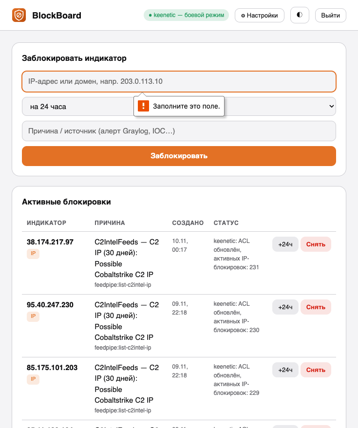
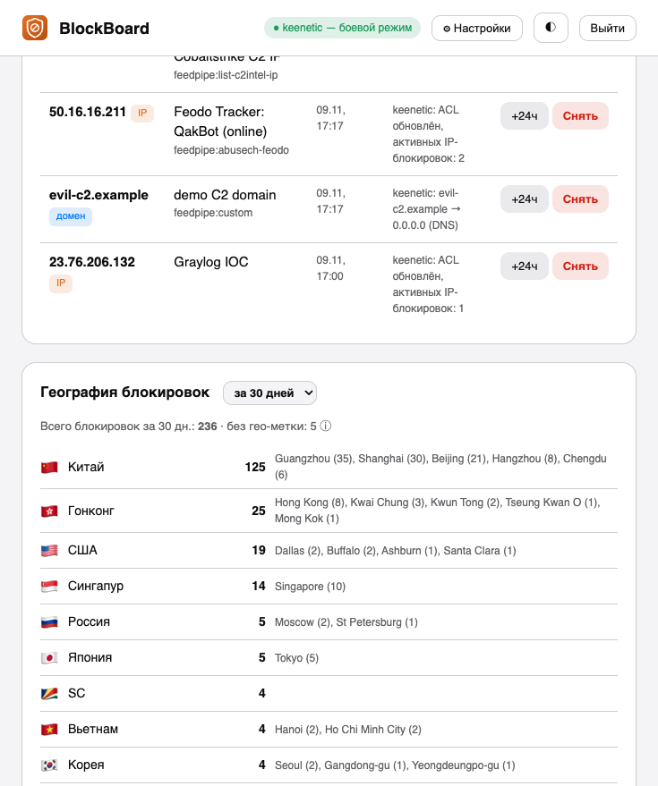

# BlockBoard

Пульт блокировки индикаторов компрометации (IOC) для домашней лаборатории безопасности.

Веб-интерфейс для блокировки IP-адресов и доменов на роутере **Keenetic** через RCI API:
каждый индикатор получает причину, срок жизни (TTL) и источник; по истечении TTL блокировка
снимается автоматически. Все действия уходят событиями в **Graylog** (GELF UDP).

## Скриншоты





## Возможности

- Блокировка IP — ACL файрвола `BlockBoard` на LAN-интерфейсе (Bridge0, направление in):
  deny-правила на каждый адрес + завершающий permit-all. ACL пересобирается из базы
  при каждом изменении (порядок правил критичен: deny должны идти раньше permit-all)
- Блокировка доменов — статическая DNS-запись `0.0.0.0` на роутере (имя перестаёт резолвиться)
- При старте сервис приводит роутер в соответствие со своей базой (self-healing)
- TTL: 1 час / 24 часа / 3 суток / неделя / бессрочно, авто-снятие по таймеру
- Режим **dry-run**: действия только журналируются, пока роутер не подключён
- Журнал действий, продление блокировок, ручное снятие
- **География блокировок**: топ стран и городов по событиям Graylog (GeoIP-пайплайн
  обогащает события `tool:blockboard`), топ причин, периоды 7/30/90 дней.
  Нужны `BB_GRAYLOG_API`, `BB_GRAYLOG_USER`, `BB_GRAYLOG_PASS` в env
- Глубокая ссылка `/?block=<IP>&reason=<текст>` — для кнопок «Заблокировать» в письмах Graylog и других инструментах
- Авторизация (сессии), светлая/тёмная тема
- Только стандартная библиотека Python — никаких зависимостей

## Запуск (Podman)

```bash
podman build -t localhost/blockboard:latest -f Containerfile .
```

Quadlet-юнит `~/.config/containers/systemd/blockboard.container`:

```ini
[Unit]
Description=BlockBoard — пульт блокировки IOC
After=network-online.target

[Container]
Image=localhost/blockboard:latest
PublishPort=8098:8098
Volume=/home/redos/blockboard/data:/data:Z
EnvironmentFile=/home/redos/blockboard/blockboard.env

[Service]
Restart=on-failure

[Install]
WantedBy=default.target
```

`blockboard.env`:

```
BB_USER=admin
BB_PASS=admin          # поменяйте!
GELF_HOST=host.containers.internal
GELF_PORT=12206
```

## Настройка Keenetic

Веб-интерфейс → ⚙ Настройки: адрес роутера, логин и пароль администратора,
кнопка «Проверить связь» выполняет `show version` через RCI.
Пароль хранится только в локальной SQLite-базе сервиса (`/data/blockboard.db`).

## API

| Метод | Путь | Описание |
|---|---|---|
| POST | `/api/login` | вход `{user, password}` |
| GET | `/api/blocks` | активные блокировки |
| POST | `/api/blocks` | новая `{indicator, reason, source, ttl_hours, save}` (`save: true` — записать startup-config сразу; по умолчанию выкл.) |
| POST | `/api/blocks/<id>/unblock` | снять блокировку |
| POST | `/api/blocks/<id>/extend` | продлить `{hours}` |
| GET | `/api/history` | журнал |
| GET | `/api/geo-stats?days=N` | география блокировок из Graylog (страны, города, причины) |
| GET/POST | `/api/settings` | настройки роутера |
| POST | `/api/test-router` | проверка связи с Keenetic |

## События в Graylog

GELF UDP, поля: `tool=blockboard`, `action=block|unblock|expire|daily-save`,
`indicator`, `itype`, `reason`, `result`, `ttl_hours`.

## Политика сохранения конфигурации Keenetic

Каждая RCI-команда `system configuration save` пишет startup-config и
порождает syslog-сообщение `StartupConfig: configuration saved`. Чтобы
автоматика не генерировала десятки таких сообщений в час (и не дёргала
правило Graylog «KEENETIC - Сохранена конфигурация роутера»), применяется
разделение:

- **Ручные действия из панели** (блокировка/разблокировка) — немедленный
  save, событие Graylog и уведомление работают как прежде.
- **Автоматика** (feedpipe, снятие блокировок по TTL) — изменения действуют
  сразу, но startup-config **не пишется** (`save=False`).
- **Дневное согласование**: фоновый поток sweeper раз в сутки в окне
  **04:17–04:27 (Asia/Yekaterinburg)** выполняет полное согласование
  роутера с БД (догоняет DNS-записи доменов, пересобирает IP-ACL) и делает
  **одно** сохранение конфигурации.

Компромисс: если роутер перезагрузится до дневного окна, автоматические
блокировки последних часов вернутся при ближайшем согласовании — либо
сразу после рестарта сервиса (при старте выполняется полное согласование
доменов и IP-ACL с save).

На стороне Graylog дневное сохранение помечается pipeline-правилом
«keenetic: mark autosave window» (поле `kn_autosave=true` для сообщений
`StartupConfig: configuration saved` в окне 04:15–04:28 по Екатеринбургу),
а в запрос правила «KEENETIC - Сохранена конфигурация роутера» добавлено
исключение `AND NOT kn_autosave:true` — автосохранение не создаёт событий
и уведомлений (в т.ч. эскалации в IRIS).

## FeedPipe — автоблокировка из фидов IOC

`feedpipe.py` — конвейер «TrafficLens → BlockBoard»: читает базу IOC
TrafficLens (SQLite), отбирает IP/домены с confidence ≥ `FP_MIN_CONF`
(по умолчанию 80) и блокирует их через API BlockBoard с TTL
(`FP_TTL_HOURS`, по умолчанию 168 ч). Мёртвые C2 (Feodo «offline»),
приватные/служебные адреса и локальные домены пропускаются.
Дедупликация — на стороне BlockBoard, поэтому скрипт идемпотентен;
за один прогон добавляется не более `FP_MAX_PER_RUN` (50) блокировок.

Запуск по таймеру (`~/.config/systemd/user/feedpipe.{service,timer}`,
каждый час в :17), учётка и параметры — в `~/blockboard/feedpipe.env`.
Проверка без изменений: `FP_DRY=1 python3 feedpipe.py`.
